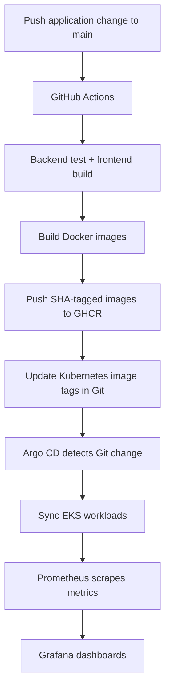

# Three-Tier Application on Amazon EKS | Terraform · Docker · GitHub Actions · Argo CD · Prometheus · Grafana

[](https://developer.hashicorp.com/terraform) [](https://aws.amazon.com/eks/) [](https://www.docker.com/) [](https://github.com/features/actions) [](https://argo-cd.readthedocs.io/) [](https://prometheus.io/) [](https://grafana.com/)

A hands-on, end-to-end DevOps portfolio project that deploys a containerized three-tier application to **Amazon Elastic Kubernetes Service (EKS)**. Terraform provisions the AWS infrastructure, GitHub Actions tests and builds container images, Argo CD deploys from Git, and Prometheus/Grafana provide observability.

> **Project status:** This repository is a deployable starter implementation. It has not been deployed into your AWS account. You must configure your own AWS credentials, replace the GitHub placeholders, set a real database password, publish or authorize image pulls from GHCR, and run the deployment steps below. Add screenshots from your own running environment after deployment.

## Contents

- [Architecture](#architecture)
- [Technology stack](#technology-stack)
- [Repository structure](#repository-structure)
- [Prerequisites](#prerequisites)
- [1. Run locally with Docker Compose](#1-run-locally-with-docker-compose)
- [2. Configure GitHub and GHCR](#2-configure-github-and-ghcr)
- [3. Provision AWS EKS with Terraform](#3-provision-aws-eks-with-terraform)
- [4. Install Argo CD](#4-install-argo-cd)
- [5. Configure GitOps](#5-configure-gitops)
- [6. Deploy monitoring](#6-deploy-monitoring)
- [7. Verify the application](#7-verify-the-application)
- [CI/CD workflow](#cicd-workflow)
- [Monitoring and useful commands](#monitoring-and-useful-commands)
- [Troubleshooting](#troubleshooting)
- [Security and cost warnings](#security-and-cost-warnings)
- [Screenshots](#screenshots)
- [Interview explanation](#interview-explanation)
- [Roadmap for taking this further](#roadmap-for-taking-this-further)

## Architecture


The workflow is: developer push → GitHub Actions tests and builds → images published to GitHub Container Registry → workflow commits immutable image tags to Git → Argo CD reconciles Kubernetes manifests → frontend/API/database run on EKS → Prometheus scrapes backend metrics → Grafana visualizes metrics.

For a detailed flow, see [`docs/architecture.md`](docs/architecture.md).

### Official architecture references

These are reference diagrams/documentation from AWS, not screenshots of this repository's deployment:

- [AWS: EKS with Terraform and Argo CD reference architecture (PDF)](https://d1.awsstatic.com/solutions/guidance/architecture-diagrams/automated-provisioning-of-amazon-elastic-kubernetes-service-using-terraform_argo.pdf)
- [AWS: Continuous deployment with Argo CD on EKS](https://docs.aws.amazon.com/eks/latest/userguide/argocd.html)
- [AWS: Terraform-based EKS setup and monitoring guidance](https://docs.aws.amazon.com/eks/latest/userguide/ml-cluster-setup-tf.html)

## Technology stack

| Layer | Technology | Responsibility |
|---|---|---|
| Frontend | React + Vite + NGINX | UI and reverse proxy for `/api` |
| Backend | Node.js + Express | REST endpoints, readiness and metrics |
| Database | PostgreSQL 16 | Persistent visit records |
| Containers | Docker + Docker Compose | Build and local multi-container run |
| Infrastructure | Terraform + AWS VPC/EKS modules | VPC, subnets, NAT, EKS and managed nodes |
| CI | GitHub Actions | Tests, builds and publishes images |
| Registry | GitHub Container Registry | Versioned container images |
| CD / GitOps | Argo CD | Pull-based reconciliation from Git |
| Orchestration | Kubernetes | Deployments, Services, StatefulSet, PVC, probes |
| Observability | Prometheus + Grafana | Metrics collection and dashboards |

## Repository structure

```text
three-tier-eks-devops/
├── .github/workflows/
│   ├── ci-cd.yml                 # Test, build, publish, update GitOps image tags
│   └── terraform-check.yml       # Terraform fmt/init/validate
├── app/
│   ├── frontend/                # React + Vite + NGINX Docker image
│   └── backend/                 # Express API + PostgreSQL + Prometheus metrics
├── argocd/
│   ├── root-app.yaml             # Application deployment from this Git repo
│   └── monitoring-app.yaml       # kube-prometheus-stack Helm chart
├── k8s/base/                     # Kubernetes manifests and Kustomize entry point
├── terraform/                   # AWS VPC + EKS managed node group
├── scripts/                     # Cluster bootstrap, connect and destroy helpers
├── docs/
│   ├── architecture.md
│   ├── architecture.svg
│   └── screenshots/              # Add your own deployment evidence here
├── docker-compose.yml
└── README.md
```

## Prerequisites

Install and configure the following on your workstation:

- AWS account with permission to create VPC, EC2, EKS, IAM, Auto Scaling and related resources.
- AWS CLI v2 configured (`aws configure` or an approved SSO profile).
- Terraform 1.6 or newer.
- `kubectl`, Docker, Git and Helm 3.
- GitHub account and a new repository created from this project.
- `kustomize` is useful for local manifest inspection; `kubectl` includes Kustomize support (`kubectl kustomize`).

Check tools:

```bash
aws --version
terraform version
kubectl version --client
helm version
docker --version
git --version
```

## 1. Run locally with Docker Compose

This is the fastest way to prove the app works before provisioning AWS.

```bash
git clone https://github.com/YOUR_GITHUB_USERNAME/YOUR_REPOSITORY.git
cd YOUR_REPOSITORY
docker compose up --build -d
docker compose ps
```

Open [http://localhost:8080](http://localhost:8080). The UI calls the backend through NGINX, and the backend writes a visit row to PostgreSQL.

Useful local checks:

```bash
curl http://localhost:8080/api/health
curl http://localhost:8080/api/
docker compose logs -f backend
docker compose down
```

To remove the local database volume too (destructive): `docker compose down -v`.

## 2. Configure GitHub and GHCR

1. Create a GitHub repository and push this project to its `main` branch.
2. Replace `OWNER/REPOSITORY` in `argocd/root-app.yaml` with your actual lowercase GitHub owner and repository name.
3. Review `.github/workflows/ci-cd.yml`. It uses the automatically provided `GITHUB_TOKEN`; repository Actions permissions must allow read/write access to repository contents and packages.
4. Ensure the GitHub Actions workflow has permission to write packages and contents. The workflow declares `contents: write` and `packages: write`.
5. After the first successful image build, open each package in GitHub Packages and either make it public or configure Kubernetes image pull credentials for private packages. Do not assume EKS can pull private GHCR images anonymously.

On a push to `main` that changes `app/**`, the workflow tests the backend, builds the frontend, publishes both images with the Git commit SHA, and commits the image tag update under `k8s/base/`. Argo CD then sees the new Git commit.

> The first deployment requires images to exist. Make an application code change and push it after enabling the workflow, or manually build and push both images before continuing.

## 3. Provision AWS EKS with Terraform

**Cost warning:** EKS control plane, EC2 worker nodes, NAT Gateway, EBS volumes and load balancers incur charges. Do not leave the lab running when you are finished. A single NAT Gateway is configured to reduce lab cost, but it is not an AZ-resilient production design.

```bash
cd terraform
cp terraform.tfvars.example terraform.tfvars
# Edit terraform.tfvars if required. Keep real *.tfvars files out of Git.
terraform init
terraform fmt -recursive
terraform validate
terraform plan -out=tfplan
terraform apply tfplan
```

The default region is `ap-south-1` (Mumbai). Defaults create a three-AZ VPC, public/private subnets, one NAT Gateway, an EKS 1.35 cluster, an EBS CSI driver with Pod Identity, and a two-node `t3.medium` AL2023 managed node group. The Kubernetes version and node AMI type are set for current EKS versions; check AWS regional availability before applying. Confirm current EKS version availability in your selected region before applying; change `kubernetes_version` if AWS no longer offers the configured version.

Connect kubectl:

```bash
aws eks update-kubeconfig --region ap-south-1 --name three-tier-platform
kubectl get nodes -o wide
```

**Network security:** The sample Terraform makes the EKS public API endpoint reachable from `0.0.0.0/0` so a learner can connect from a changing IP. Before applying in a real environment, change `cluster_endpoint_public_access_cidrs` in `terraform/main.tf` to your trusted public IP in CIDR notation (for example, `203.0.113.10/32`). Do not use the example documentation IP as your actual IP.

## 4. Install Argo CD

```bash
cd ..
./scripts/bootstrap-argocd.sh
kubectl -n argocd get pods
```

For a local UI session, port-forward the Argo CD server:

```bash
kubectl port-forward svc/argocd-server -n argocd 8081:443
```

Open [https://localhost:8081](https://localhost:8081). The initial admin password can be retrieved using:

```bash
kubectl -n argocd get secret argocd-initial-admin-secret \
  -o jsonpath='{.data.password}' | base64 -d; echo
```

Change the initial password and do not publish it in GitHub, screenshots or project documentation.

## 5. Configure GitOps

1. Edit `argocd/root-app.yaml` and set `repoURL` to your repository's HTTPS Git URL.
2. Confirm `targetRevision: main` matches your default branch.
3. Create the namespace before applying the demo Secret. Set a real password in a Kubernetes Secret. For a learning-only first run, edit `k8s/base/secret.example.yaml`, then apply it manually:

```bash
kubectl create namespace three-tier --dry-run=client -o yaml | kubectl apply -f -
kubectl apply -f k8s/base/secret.example.yaml
```

Do not commit a real secret. For a safer workflow, create the Secret out-of-band or integrate AWS Secrets Manager and External Secrets Operator. The example secret file contains a deliberately unusable placeholder.

4. Install the monitoring application first so its ServiceMonitor CRD exists before the application GitOps sync: 

```bash
kubectl apply -f argocd/monitoring-app.yaml
kubectl wait --for condition=Established crd/servicemonitors.monitoring.coreos.com --timeout=300s
```

5. Apply the Argo CD root application:

```bash
kubectl apply -f argocd/root-app.yaml
argocd app get three-tier-platform   # if the Argo CD CLI is installed
kubectl get pods -n three-tier -w
```

5. Verify the frontend LoadBalancer address:

```bash
kubectl get svc frontend -n three-tier -w
```

Open the `EXTERNAL-IP` / hostname in a browser once provisioned.

### Important: image names and access

The GitHub Actions workflow writes images to `ghcr.io/<owner>/<repo>-frontend:<commit-sha>` and `ghcr.io/<owner>/<repo>-backend:<commit-sha>`. It updates the placeholders in the Kubernetes manifests. Confirm the workflow has completed successfully and both packages can be pulled by the cluster. If packages are private, create a `kubernetes.io/dockerconfigjson` Secret in the `three-tier` namespace and reference it with `imagePullSecrets` in both Deployments.

## 6. Verify monitoring

The monitoring Argo CD Application was applied in the previous step. Wait for its components to become ready:

```bash
kubectl get pods -n monitoring -w
```

The chart installs Prometheus, Grafana, Alertmanager, kube-state-metrics and node-exporter. A `ServiceMonitor` in `k8s/base/servicemonitor.yaml` selects the backend Service and scrapes `/metrics`. Terraform also installs the EBS CSI add-on and configures Pod Identity so the PostgreSQL PVC can provision encrypted `gp3` storage.

For a lab UI session:

```bash
kubectl port-forward svc/monitoring-grafana -n monitoring 3000:80
```

Open [http://localhost:3000](http://localhost:3000). The sample Helm values set a placeholder admin password. Before using the UI, replace it with a strong value through a Kubernetes Secret / secure Helm values workflow. Do not use the placeholder password for a public-facing service.

Prometheus UI:

```bash
kubectl port-forward svc/monitoring-kube-prometheus-prometheus -n monitoring 9090:9090
```

Open [http://localhost:9090](http://localhost:9090). Search for `http_requests_total` after calling the API a few times.

## 7. Verify the application

```bash
kubectl get all -n three-tier
kubectl get pvc -n three-tier
kubectl get servicemonitor -n three-tier
kubectl describe pods -n three-tier
```

Test the external application:

```bash
curl http://<FRONTEND-LOADBALANCER-HOST>/api/health
curl http://<FRONTEND-LOADBALANCER-HOST>/api/
```

Expected API health response:

```json
{"status":"ok","service":"backend"}
```

The root API endpoint should return a message, visit record and total visit count. Reloading the UI or calling `/api/` should increase the count.

## CI/CD workflow



**Why both CI and GitOps?** GitHub Actions validates source code and creates immutable image artifacts. It does not run `kubectl apply` against the cluster. Argo CD is the deployment controller: it pulls the desired state from Git and continuously reconciles drift. This keeps deployment history reviewable and avoids long-lived cluster credentials in the CI workflow.

## Monitoring and useful commands

| Task | Command |
|---|---|
| Pods | `kubectl get pods -A` |
| App services | `kubectl get svc -n three-tier` |
| StatefulSet | `kubectl get sts -n three-tier` |
| Persistent volume claims | `kubectl get pvc -n three-tier` |
| Backend logs | `kubectl logs deploy/backend -n three-tier --tail=100` |
| Frontend logs | `kubectl logs deploy/frontend -n three-tier --tail=100` |
| Previous crashed container | `kubectl logs <pod> -n three-tier --previous` |
| Pod events | `kubectl describe pod <pod> -n three-tier` |
| Argo CD applications | `kubectl get applications -n argocd` |
| Monitoring pods | `kubectl get pods -n monitoring` |
| Node utilization | `kubectl top nodes` |
| Pod utilization | `kubectl top pods -n three-tier` |

Useful Prometheus queries:

```promql
sum(rate(http_requests_total[5m]))
sum by (status) (rate(http_requests_total[5m]))
rate(container_cpu_usage_seconds_total{namespace="three-tier"}[5m])
container_memory_working_set_bytes{namespace="three-tier"}
```

## Troubleshooting

| Symptom | What to inspect |
|---|---|
| `ImagePullBackOff` | Confirm image exists, tag matches, GHCR package is public or `imagePullSecret` is configured. |
| Backend readiness fails | `kubectl logs deploy/backend -n three-tier`; verify Secret, ConfigMap and PostgreSQL readiness. |
| PostgreSQL PVC pending | Check EBS CSI add-on, StorageClass `gp3`, node/AZ placement and PVC events. |
| Frontend loads but API fails | Check `backend` Service endpoints and NGINX proxy logs; confirm backend listens on port 3000. |
| Argo CD OutOfSync | Inspect repository URL, branch, path and manifest errors in the Argo CD Application. |
| No backend metrics | Check `ServiceMonitor` labels, Prometheus target health and `/metrics` endpoint. |
| LoadBalancer pending | Inspect Service events, subnet tags, AWS permissions and AWS Load Balancer provisioning events. |

## Security and cost warnings

This is an educational portfolio implementation, not a production-ready reference architecture. Before production use:

- Restrict the EKS API endpoint to trusted CIDRs or use private endpoint access.
- Do not store real credentials in Git. Use AWS Secrets Manager / Parameter Store and External Secrets Operator.
- Prefer Amazon RDS/Aurora over a single-replica PostgreSQL pod; configure backups, encryption, failover and recovery tests.
- Use private GHCR packages with scoped pull credentials or a private Amazon ECR repository with an appropriate IAM role.
- Add image scanning (Trivy), SBOM generation, signing, dependency scanning and admission policies.
- Add TLS, DNS, ingress/WAF controls, network policies, pod security standards and least-privilege RBAC.
- Use multi-AZ NAT or VPC endpoints where appropriate; configure budgets and alerts.
- Add PodDisruptionBudgets, autoscaling, resource quotas, alert rules and tested restore procedures.
- Pin action versions to reviewed commit SHAs for hardened supply-chain security.

**Cost control:** Run `terraform destroy` when finished. Deleting the cluster does not always remove every manually created resource or retained volume. Check the AWS console for leftover load balancers, EBS volumes, NAT gateways, elastic IPs and snapshots. Review the AWS Pricing Calculator before deploying.

## Screenshots

After deploying, capture your own evidence and add it to `docs/screenshots/`. Suggested filenames and descriptions are in [`docs/screenshots/README.md`](docs/screenshots/README.md). Then add images here, for example:

```markdown


```

Do not present internet screenshots or another person's dashboard as evidence of your own deployment. The AWS and Argo CD references above are for learning architecture patterns only.

## Interview explanation

**Short project explanation:**

"I built a three-tier application and deployed it on Amazon EKS. I containerized a React frontend and Node.js API, with PostgreSQL as the data layer. I used Terraform to provision the AWS VPC and EKS cluster. GitHub Actions runs tests, builds Docker images and pushes immutable tags to GHCR. The pipeline updates Kubernetes manifests in Git, and Argo CD continuously syncs those manifests to EKS using GitOps. I integrated Prometheus and Grafana to monitor application and cluster metrics."

Be prepared to explain:

1. Why use a Deployment for stateless frontend/API but a StatefulSet and PVC for PostgreSQL?
2. What is the difference between readiness and liveness probes?
3. How does a Kubernetes Service provide stable networking for changing Pods?
4. How does Argo CD detect and correct configuration drift?
5. Why publish immutable image tags instead of using `latest`?
6. How do Terraform state and modules work? Where should remote state and locking live?
7. How would you protect database credentials and private container images?
8. How would you diagnose `CrashLoopBackOff`, `Pending` PVCs and `ImagePullBackOff`?
9. What is the difference between Prometheus scraping and Grafana querying?
10. What would you change to make the database highly available?

## Roadmap for taking this further

- [ ] Move PostgreSQL to Amazon RDS with private networking and automated backups.
- [ ] Add AWS Load Balancer Controller + Ingress + ACM TLS certificate + Route 53.
- [ ] Add HPA, Cluster Autoscaler or Karpenter and PodDisruptionBudgets.
- [ ] Add Trivy image/IaC scans, SBOM, image signing and policy checks.
- [ ] Store Terraform state in S3 with native state locking and encryption.
- [ ] Add External Secrets Operator backed by AWS Secrets Manager.
- [ ] Add Prometheus alert rules, Alertmanager routing and an SLO dashboard.
- [ ] Add staging and production overlays with Kustomize and pull-request promotion.
- [ ] Add load testing (k6), failure injection and documented recovery exercises.

## Cleanup

Delete the Argo CD-managed apps / workloads if desired, then destroy the Terraform infrastructure:

```bash
./scripts/destroy-infra.sh
```

If the cluster cannot be destroyed because of AWS dependencies, inspect the Terraform error and remove the blocking Kubernetes LoadBalancer Service / manually created resources before retrying. Always verify that billable resources are gone.

## License

MIT — see [LICENSE](LICENSE).
