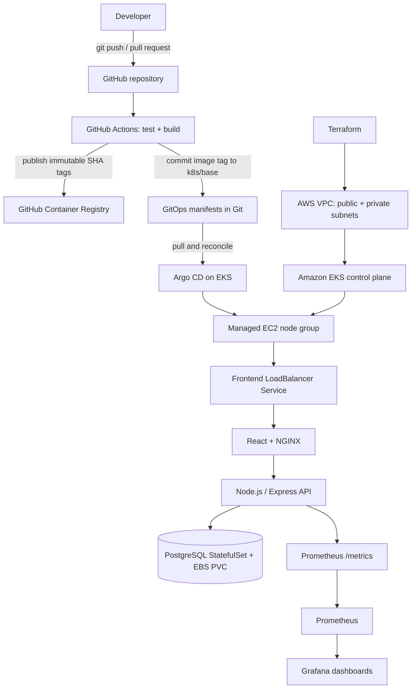

# Architecture and request flow

## Main flows

1. Terraform creates a multi-AZ VPC, private worker subnets, public subnets, NAT gateway, EKS control plane and managed node group.
2. GitHub Actions tests both app tiers, builds two Docker images and publishes immutable commit-SHA tags to GHCR.
3. The workflow updates the Kubernetes image references in Git. Argo CD detects the commit and reconciles the cluster.
4. The frontend is exposed through a Kubernetes `LoadBalancer` Service. NGINX forwards `/api/*` requests to the internal backend Service.
5. The backend writes visit records to PostgreSQL. Prometheus scrapes `/metrics`; Grafana visualizes metrics.

## Important design notes

- PostgreSQL as a single-replica StatefulSet with an EBS volume is a learning setup, not a highly available production database. Use Amazon RDS/Aurora, backups, encryption and tested recovery for production.
- The EKS API endpoint is public in this lab configuration. Restrict `cluster_endpoint_public_access_cidrs` to your current trusted IP range before provisioning.
- A single NAT gateway reduces lab cost but is a single-AZ dependency. Production designs typically use NAT per AZ or private connectivity endpoints.
- Kubernetes Secret manifests are demo-only. Use AWS Secrets Manager with External Secrets Operator or another managed secret integration for real credentials.
